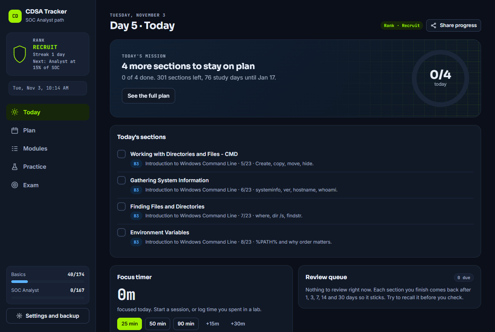
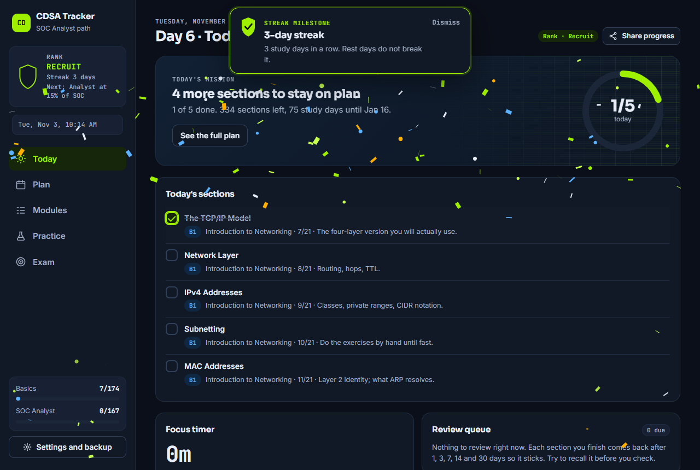
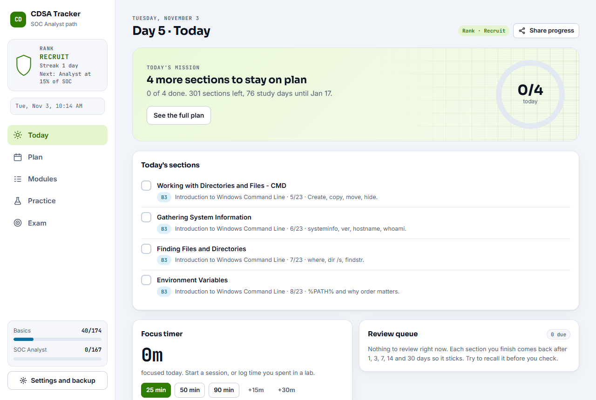
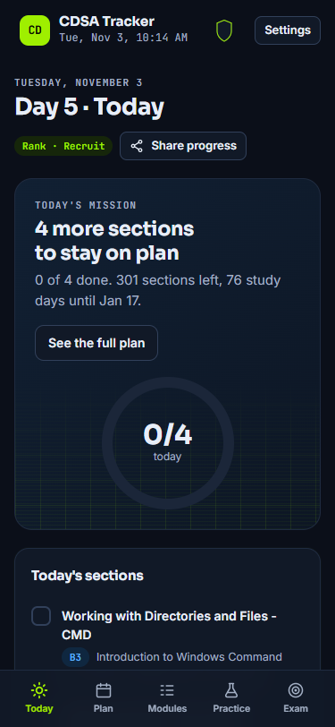
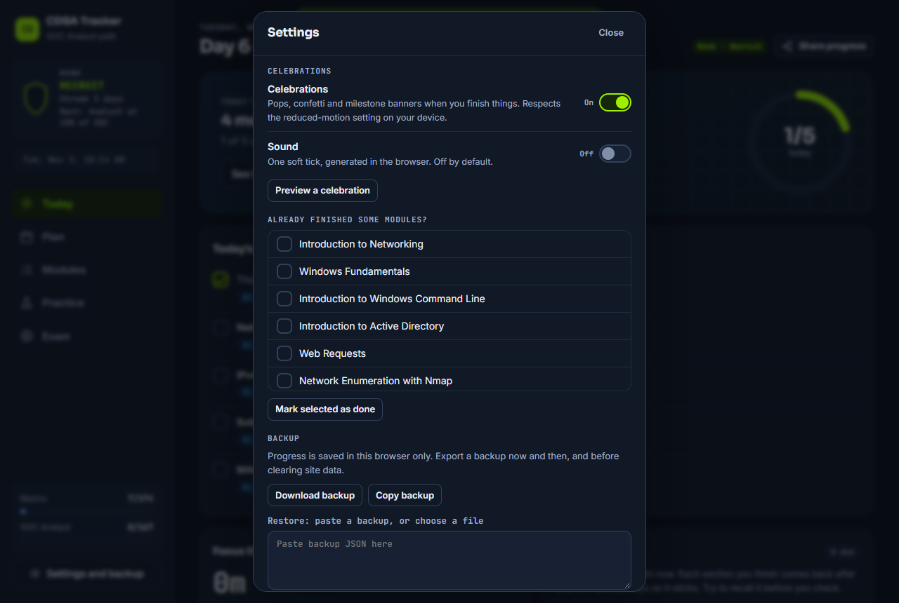

# CDSA Study Tracker

A free, single-file study tracker for the Hack The Box **SOC Analyst path** and the **CDSA** exam. Every Academy section is its own checkbox, the plan adapts day by day, and it cheers you on when you finish things.

**No accounts. No backend. No analytics. No network requests.** Your progress lives in your own browser and never leaves it.



> **Not affiliated with Hack The Box.** "Hack The Box", "HTB", "CDSA" and "Academy" belong to their owners. This is an independent study aid. It uses no HTB logo or artwork, and it does not reproduce Academy course text: module and section titles follow the public syllabus and everything else (guides, hints, practice ideas) is original.

## Use it

Pick one:

- **Open the live page** if the owner has enabled GitHub Pages for this repository (Settings, Pages). Bookmark it. Your progress is saved against that address.
- **Download it.** Save `index.html` and double-click it. It works offline. Keep the file in one place: progress is stored per file location, so moving it looks like a reset (restore a backup to recover).
- **Host your own copy.** Fork this repository, then in **Settings, Pages** choose "Deploy from a branch", branch `main`, folder `/ (root)`. Your copy is then at `https://YOUR-USERNAME.github.io/REPO-NAME/`.

Your first visit starts the plan that day. There is nothing to configure.

### Keep your progress safe

Progress is saved in this browser only, automatically, including when you close the tab. It is **not** synced between devices and it is erased if you clear site data. So:

1. Open **Settings and backup** and press **Download backup** now and then, and before clearing browser data.
2. To move to another browser or device, restore that file with **Restore** in the same dialog.

## What it does

- **341 checkboxes** across 25 modules. Stage 0 (the basics, Academy prerequisites path, 174 sections) comes first; Stage 1 is the 15 SOC Analyst modules (167 sections).
- **Adaptive day-by-day plan** that re-plans from what is left. It reads the device clock live and rolls over at midnight.
- **Spaced-repetition review queue** (1, 3, 7, 14, 30 days), a **focus timer**, **streaks that ignore rest days**, milestones and a share card.
- **Per-module guides** (why it matters, what you will learn, practice alongside, ready-when), section hints, bookmarks and notes.
- **Problem roadmap**: problems to do after finishing each module, a final exam-rehearsal stage, and tips from people who passed. Platforms rename labs and move them between free and paid, so check a lab before you rely on it. Lab links are not verified.
- **Exam tab**: a readiness checklist, exam facts, timeline and report templates, and an "if I see this, I check that" list.

## Celebrations

Short, tasteful feedback when you finish something. Plain CSS plus a small canvas particle system, no libraries.

| You do this | What happens |
| --- | --- |
| Tick a section | Checkbox pops, a green check draws itself, the row glows briefly |
| Finish a module | Confetti from the module card, a one-line toast with a varied message, the progress bar fills with a shine sweep |
| Hit today's quota | The ring on Today closes with a pulse and a small burst; the headline changes to "Quota cleared" |
| Tick a roadmap problem | A smaller pop and sparkle |
| Reach a 3, 7, 14 or 30 day streak, earn a badge, finish a stage, or finish all 167 SOC sections | Full-width confetti for about two seconds and a banner naming the achievement |
| Tick the last item on the readiness checklist | A "Ready to book" banner |

- **Real actions only.** Nothing fires on page load or when you restore a backup. Milestones you have already reached are sealed silently.
- **Once per milestone.** Reached milestones are stored (`cel` in the saved state), so unticking and re-ticking never replays one.
- **Never in the way.** Particles use `pointer-events:none`, clean up after themselves and are capped (130, or 60 on low-end devices). Banners are dismissible and never block clicks or scrolling.
- **Reduced motion.** With `prefers-reduced-motion: reduce` there are no particles and no animation: a static highlight is used instead.
- **Sound** is off by default. When on, it plays one soft synthesized tick (Web Audio, no audio files).



## Theme

A Hack The Box inspired look, in **colours and style only**.

- **Dark by default**: deep navy-black (`#0B0F19`, cards `#111927`), bright green `#9FEF00` for primary actions, progress and ticks, with cyan `#5CB2FF`, amber `#FFAF00`, and red `#FF3E3E` for warnings only.
- **Light and System** work too. Light uses a darker green (`#2F7D00`, text `#286B00`) so the accent passes contrast on white.
- **Terminal feel**: monospace for labels, numbers, chips and the clock, a clean sans for body text, and a faint grid and scanline texture in the Today hero only. System fonts are used, so there are no font downloads.
- **CDSA touches**: a shield in the sidebar that fills as the SOC path completes, and a rank beside your streak: Recruit, Analyst (15%), Hunter (40%), Responder (70%), CDSA-ready (100%).
- **Accessible**: text contrast meets WCAG AA in every theme, focus rings are visible, and nothing relies on colour alone.

| Light | Phone (375px) |
| --- | --- |
|  |  |

## Settings

Open **Settings and backup**.

- **Celebrations** (on by default) and **Sound** (off by default). **Preview a celebration** shows one. Stored as `celeb` and `sound`.
- **Theme**: System, Light, Dark. New visitors get Dark.
- Plan length, exam date, study days, "already finished" modules, backup and restore, reset.



## Privacy and security

- **Nothing leaves your device.** No server, no accounts, no analytics, no cookies, no third-party fonts or scripts. The page ships a Content-Security-Policy that forbids network access (`connect-src 'none'`) and allows its own scripts only by hash.
- **Your data** is in `localStorage` under `cdsa-tracker-v4`. It is not encrypted, so keep secrets out of your notes.
- **Hostile input** is handled: saved data is escaped on output, and restoring a malicious backup is covered by a test.

Details, limits and how to report a vulnerability are in [SECURITY.md](SECURITY.md).

## Develop

Edit only `src/`, then rebuild `index.html`:

```
python3 src/build.py
```

(`py src/build.py` on Windows.) `build.py` has no dependencies. It stitches the sources into `index.html` and writes the Content-Security-Policy with the hashes of the inline scripts, so always rebuild after a change.

```
src/
  template.html   page shell and slots
  style.css       theme, layout, celebration styles
  data0.js        Stage 0 modules and sections
  data1.js        Stage 1 (SOC Analyst) modules and sections
  data2.js        labs, resources, readiness checklist, templates
  data3.js        problem roadmap, final rehearsal, tips from people who passed
  app.js          state, planner, views, celebrations
  build.py        build + CSP
tests/e2e.js      Playwright checks (dev only)
docs/             screenshots
```

### Tests

`tests/e2e.js` drives the built page in the Chrome or Edge you already have, at 375px and 1280px, in dark, light and reduced-motion modes. It checks that each celebration fires exactly once, that reload and restore replay nothing, that old saved data still loads, that there is no horizontal scroll, that text meets AA contrast, that a hostile backup cannot inject anything, that the page makes no network requests, and that there are no console errors.

```
npm i playwright-core            # in any folder outside this project
NODE_PATH=<that folder>/node_modules node tests/e2e.js
SHOTS=1 NODE_PATH=... node tests/e2e.js     # also refreshes docs/*.png
```

CI rebuilds `index.html` on every push and fails if the committed copy is stale.

## Contributing

Issues and pull requests are welcome. Read [CONTRIBUTING.md](CONTRIBUTING.md) first: vanilla JS only, no network, no course text, keep saved data backward compatible.

## License

[MIT](LICENSE). Use it, fork it, share it.
